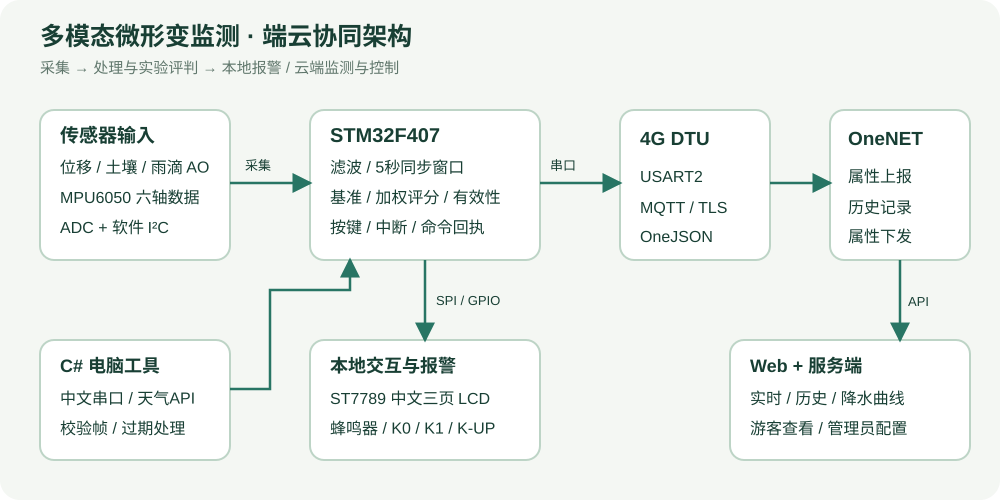
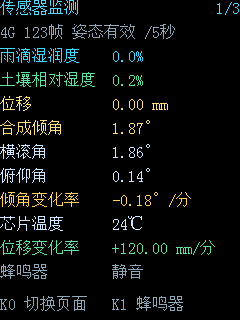

# 多模态微形变监测与预警系统

**STM32F407 · 标准外设库 · ST7789中文LCD · 4G/MQTT · OneNET · Web历史曲线**

面向边坡微形变监测场景的毕业设计实验原型：把位移、姿态、土壤与雨滴传感器接入STM32，通过中文屏幕显示、蜂鸣器报警和4G云端上报，形成从采集、处理、评判到远程展示与控制的完整链路。

> 本仓库为公开求职展示版，保留可阅读、可构建的核心实现。所有产品与设备标识均为示例值，不包含运行账号、密钥、个人报告或私有云端数据。实验评分不作为实际边坡安全判定依据。



## 快速了解

| 关注点 | 实现与入口 |
| --- | --- |
| 嵌入式采集 | STM32F407标准库，ADC采集位移/湿度/雨滴，软件I²C读取MPU6050；[主程序](firmware/USER/main.c) |
| 数据处理 | 低通滤波、显示死区、5秒同步窗口、合成倾角与变化率；[倾角算法](firmware/USER/tilt.c)、[位移采集](firmware/POSITION/position.c) |
| 本地交互 | 240×320 ST7789中文三页，K0切页、K-UP设基准、K1三档试鸣；[显示逻辑](firmware/USER/display.c) |
| 规则与执行 | 五指标加权评分、连续窗口确认、缺测处理、自动报警优先；[评分](firmware/USER/risk.c)、[蜂鸣器](firmware/USER/buzzer.c) |
| 端云通信 | USART2连接4G DTU，MQTT/OneJSON上报，解析云端属性设置并回执；[4G链路](firmware/MODEM/modem.c)、[命令解析](firmware/USER/cloud_command.c) |
| 电脑工具 | C# WinForms中文串口助手，控制字符过滤、日志限长、天气API解析、校验帧转发；[源码](tools/serial-assistant/WeatherBridge.cs) |
| 网页 | TypeScript/React、Recharts、服务端OneNET鉴权、实时读数与历史曲线、游客/管理员分权、规则下发；[网页源码](web) |

## 已实现的功能

- **传感器页**：位移、5秒平均位移、合成倾角、横滚/俯仰、变化率、土壤相对湿度、雨滴板湿润度与IMU温度。
- **天气页**：电脑获取长沙城市网格天气，经USART1转发。三日降水范围为北京时间的**昨天＋今天＋明天**，显示累计量和日均量；今天包含全日估计，明天为预报。
- **评判页**：显示位移/倾角相对人工基准的变化，结合湿度、雨滴湿润度及三日降水计算实验评分。
- **报警交互**：安全时可手动试鸣；预警间歇响，危险持续响。自动报警优先于按键和云端手动关闭。
- **远程监测**：网页实时数据、按所选时间范围绘制的历史曲线、CSV导出与天气逐小时/逐日曲线。
- **参数配置**：管理员设置权重与分档边界，服务端校验后通过OneNET下发；设备校验版本并保存配置，回执后展示执行状态。

## 核心算法与工程处理

### 准静态重力倾角

对加速度三轴低通滤波后，计算合成倾角：

```text
tilt  = atan2(sqrt(ax² + ay²), az) × 180/π
roll  = atan2(ay, az) × 180/π
pitch = atan2(-ax, sqrt(ay² + az²)) × 180/π
```

这是基于重力方向的准静态倾角估计，不估计航向角。强线性加速度会干扰结果；代码对明显冲击、失重和长采样间断标记无效，不宣称动态姿态融合或特定测量精度。

### 同步窗口、基准和评分

位移平均量与倾角变化率使用共同的5秒有效窗口；K-UP记录人工基准，避免运行中自动追踪基准掩盖缓慢变化。五项指标先各自分档，再按默认权重32%/28%/20%/12%/8%合成0～3分。权重与边界可配置，具体默认值及优先级见[算法说明](docs/algorithms.md)。

ADC使用长采样时间、换通道后丢弃首样并均值处理；湿度显示使用低通及死区。缺测和过期不补成零，完整性不足时不输出完整评分，也不会静默消除已有报警。

### 端云可靠性

串口采用中断接收、缓冲和按行解析；天气帧带校验与时间范围验证。规则下发校验字段范围、版本与总权重，使用Flash记录保存配置。网页区分命令提交、设备回执和属性回读，遇天气接口限流时退避并使用有效缓存；异步I/O保持请求独立，不跨请求复用未完成任务。

## 目录

```text
firmware/                Keil5工程、标准库、驱动与应用
  USER/                  主程序、评分、天气、按键、串口等
  LCD/ MPU6050/          显示与IMU驱动
  POSITION/ MODEM/       位移与4G驱动
  CORE/ FWLIB/           CMSIS与STM32标准库，保留原版权说明
tools/serial-assistant/  C#串口工具与Windows构建脚本
web/                    网页及服务端接口、数据库迁移
cloud/                  OneNET物模型、脱敏DTU控制示例
docs/                   架构、接线、算法、运行和验证说明
tests/                  固件ARM仿真、天气范围等回归检查
assets/                 架构图与标注为示意的界面素材
```

## 运行与构建

**固件：** 使用Keil5及ARM Compiler 5打开 [`firmware/USER/LCD_ST7789.uvproj`](firmware/USER/LCD_ST7789.uvproj)，编译后按实际STM32F407VE开发板配置SWD和Flash算法。云端接入先编辑 `firmware/USER/project_config.h` 中的示例标识，并在自己的DTU/服务器配置凭据。

**串口工具：** Windows安装.NET Framework 4.8后执行 `tools/serial-assistant/build.cmd`，再执行 `start.cmd`。使用3.3V TTL、115200/8N1；先连接自己的串口，配置自己的物模型后再启用天气云端上报。

**网页：** Node.js ≥22.13，进入 `web`，执行 `npm ci`、`npm run dev`。未配置OneNET时页面保留空读数，不伪造设备数据。数据库初始化和可选云端接入见[运行说明](docs/getting-started.md)。

接线表见 [docs/wiring.md](docs/wiring.md)。固件重启后保持传感器静止，等待完整窗口，再按K-UP设置基准。

## 界面示意



上图是LCD排版验证素材，使用模拟数据，**不是实物测量结果或精度证明**；字段及数值以当前代码和实际设备为准。

## 验证与边界

公开副本的构建及回归结果见 [验证记录](docs/verification.md)。项目已在原型硬件上完成传感器显示、按键切页、基准设置、串口转发、云端上报和蜂鸣器控制联调；这不等于完成了现场长期试验。

土壤和雨滴百分比为相对量；位移端点需要逐台标定；重力倾角适用于准静态场景；城市天气网格不代表现场雨量。GPS定位尚未完成有效定位验证，不列为已实现功能。

## 第三方来源

CMSIS、STM32标准库及网页构建脚手架包含第三方代码，保留了各文件的原始版权与许可说明，见[第三方说明](THIRD_PARTY_NOTICES.md)。公开可见不等于对所有第三方文件重新授予统一许可。
